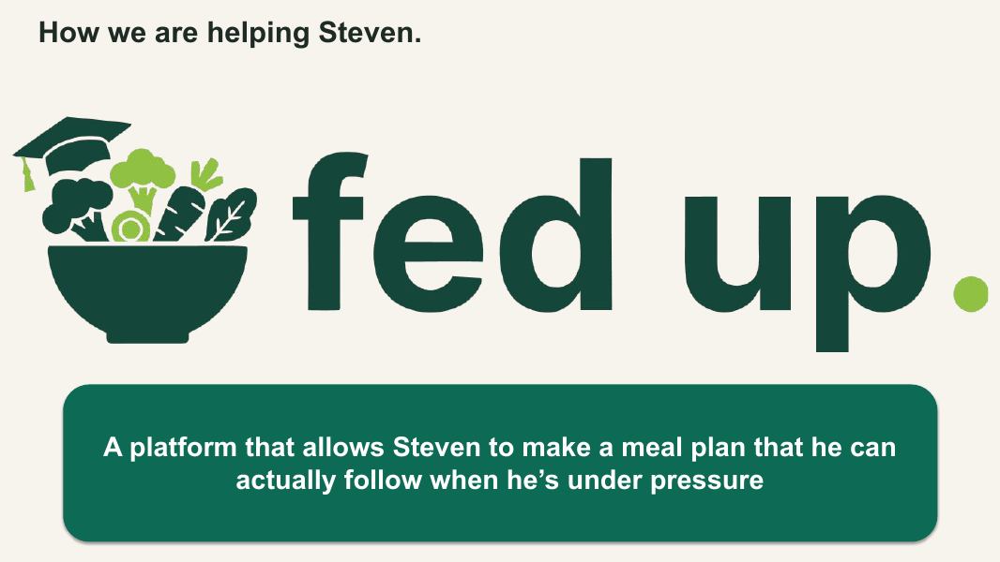
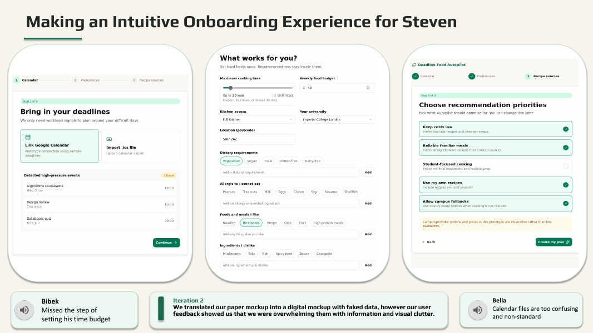
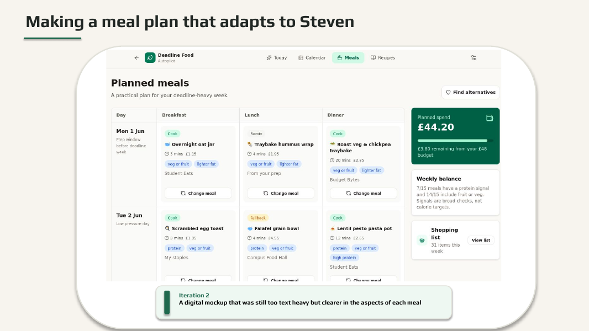
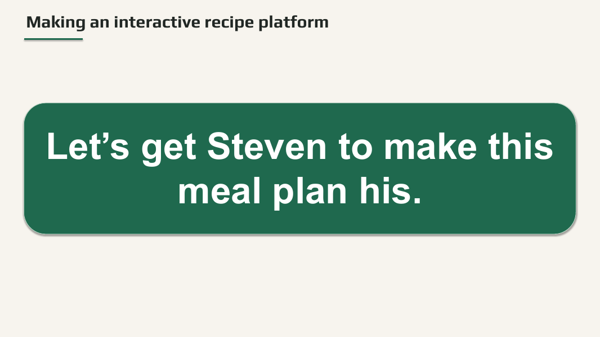
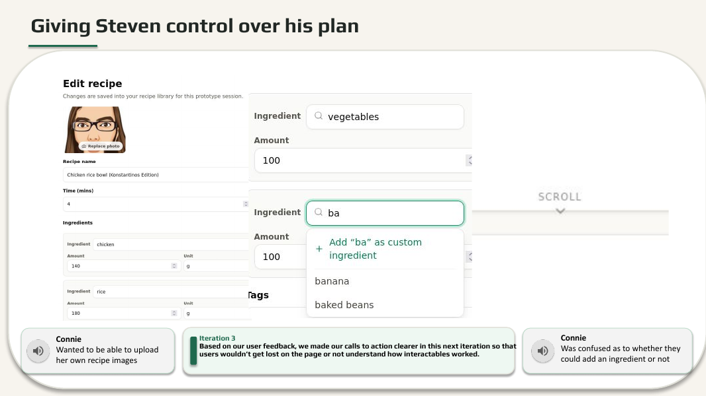
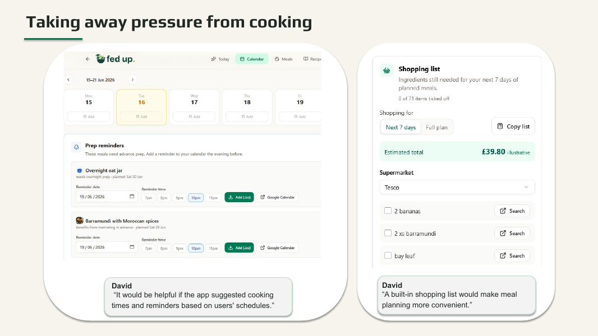

# Fed Up

> A human-centred meal-planning web app that helps students eat well when coursework takes over.

Fed Up was created as part of a **university group project** by Team DRP03. It is designed for deadline-driven students who understand the value of healthy food but struggle with time, energy, budget, shared-kitchen constraints and decision fatigue.

The central idea is simple: make the next realistic meal easier to choose, adapt and cook—without treating a broken plan or ready-meal fallback as failure.

## What it does

- Collects a student's preferences, dietary requirements, budget, cooking capacity and workload.
- Generates a practical meal plan around the week the student actually has.
- Lets users quickly change meals when plans shift.
- Supports recipe discovery, saving, personal recipes and community sharing controls.
- Builds shopping lists from planned recipes.
- Connects meal planning to calendar and workload context.
- Uses recipe images, clear tags and visible trust states such as verified and community recipes.

## Product walkthrough

### 1. Onboarding around real constraints

The onboarding flow turns vague goals into useful inputs: time, budget, dietary needs, cooking preferences and workload.

### 2. A plan that can adapt

The dashboard gives students an immediate next action and makes swapping a normal part of following the plan.

### 3. Recipes and discovery

Recipe discovery is designed for both organised meal-preppers and users who choose food more spontaneously. Recipes can be browsed, saved, adapted and used to build a shopping list.

Calendar context and shopping support extend the experience beyond a single screen, helping the plan fit into everyday student routines.

## Human-centred design process

The project used an iterative research and testing process rather than assuming that students simply needed more nutritional information:

- 8 semi-structured interviews with 10 interviewees.
- A cleaned survey dataset of 72 responses.
- Persona, stakeholder mapping, AEIOU field research and journey mapping.
- Paper prototypes, digital mockups and a deployed walking skeleton.
- Think-aloud usability sessions supported by PostHog behavioural analytics.
- Approximately 130 improvements captured through GitLab issues and merge requests.

Research showed that academic pressure, time scarcity and tiredness were stronger barriers than lack of cooking knowledge. This shifted the product towards reducing friction: clearer click targets, faster meal changes, realistic fallbacks, visible recipe states and simpler calendar interactions.

## Technical overview

The prototype uses a modern full-stack architecture:

- **Frontend:** React, TypeScript, Tailwind CSS and shadcn/ui
- **Backend:** Node.js 24 Cloud Functions, Firebase Authentication and Firestore
- **Recipe intelligence:** FastAPI, PostgreSQL with pgvector and Sentence Transformers
- **Data sources:** USDA and OpenFoodFacts, with cached facts where appropriate
- **Delivery and tooling:** Bun, Docker, GitLab CI, Vercel, Playwright and PostHog

## What I learned

Fed Up was a practical university project combining software engineering with product discovery. The strongest lesson was that small interaction details matter when users are tired or under pressure: a non-clickable card, unclear label or hidden state can be enough to break the experience. Combining qualitative feedback with behavioural analytics helped the team identify both what users said and what they actually struggled to do.

## Team contributions

This project was developed collaboratively with:

- [@bananadado](https://github.com/bananadado)
- [@dorianturner](https://github.com/dorianturner)
- [@lucashutton](https://github.com/lucashutton)

The team contributed across research, human-centred design, prototyping, frontend and backend development, testing, analytics and project delivery.

## Further reading

- [Final presentation slides](final_presentation_slides.pdf)
- [Human-centred design techniques portfolio](hcd_techniques_portfolio.pdf)

## Status

Fed Up is a university group project and working prototype. Future directions identified by the team include more intelligent meal-plan suggestions, a stronger recipe community and app-store delivery.
